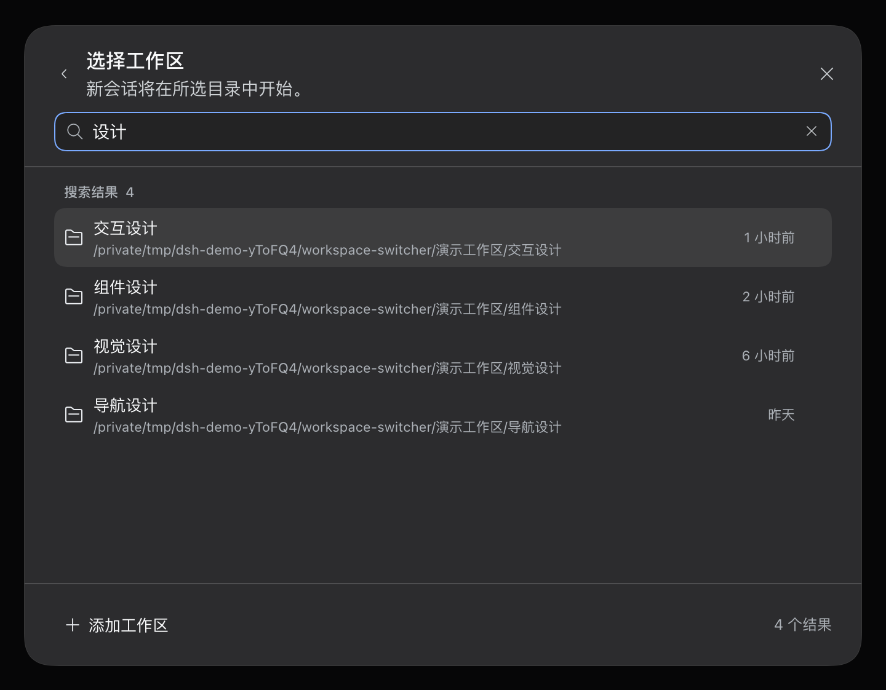

# @miorin/dsh-workspace-switcher

[简体中文](README.zh.md)

Search and switch sessions or browse the workspace tree from a shared dialog.

- **Mod+K** (also **Mod+Alt+K** on macOS/Windows Web) searches recent sessions across title, workspace,
  path, ID, and message content (when enabled by the DSH deployment).
- **Mod+Shift+K** opens the workspace view (`Space` expands/collapses a focused workspace,
  `Enter` starts a new session there); clicking the New Session workspace chip and **All N** opens the chooser.
- **Ctrl+Tab** jumps between recent sessions in the current window (default on macOS and Windows Desktop;
  configurable in **Settings → Shortcuts**).
- Use **View options** to change grouping, order, or archive filter; press `Shift+F10`,
  click `…`, or right-click a row for DSH actions; **Add workspace** uses the local Host picker.

Requires DeepSeek Harness `0.2.2-rc.3` or newer.
This bundle is part of **Workspace Modular Improvement Plan** (`@miorin/dsh-atlas-workspace`);
install either one, never both.
For standalone use, run `pnpm install --frozen-lockfile` and select this directory in **Plugins → Add plugin**
(or via `plugin_manager`).

## Screenshots

The screenshots show a workspace search in the Chinese interface.

| | Light | Dark |
| --- | --- | --- |
| Workspace search |  |  |
| Workspace chip |  |  |

[Project documentation](docs/README.md)
