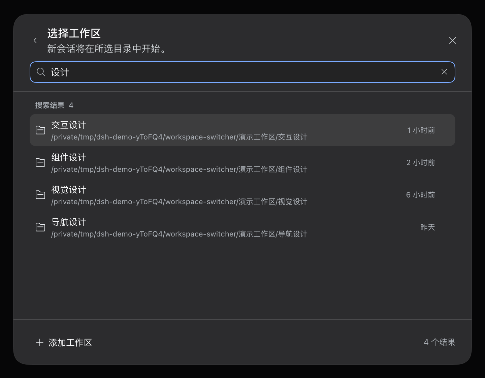

# @miorin/dsh-workspace-switcher

[English](README.md)

在同一套弹窗中检索、切换会话和浏览工作区树。

- **Mod+K**（macOS / Windows Web 版也可用 **Mod+Alt+K**）按标题、工作区、路径、
  会话 ID 及消息正文（随 DSH 部署设置）检索最近会话。
- **Mod+Shift+K** 打开工作区分组视图（聚焦工作区按空格展开/折叠、按回车新建会话）；
  在新会话页点击工作区标签再点 **全部 N 个** 可展开工作区选择器。
- **Ctrl+Tab** 在当前窗口的最近会话间往返切换（默认绑定于 macOS / Windows 桌面端，可在 **设置 → 快捷键** 调整）。
- 通过 **视图选项** 切换分组、排序与归档筛选，右键、省略号或 `Shift+F10` 可打开行操作菜单；
  **添加工作区** 调用本机 Host 目录选择器。

需要 DeepSeek Harness `0.2.2-rc.3` 或更新版本。
本插件已包含于 **工作区模块化改良计划**（`@miorin/dsh-atlas-workspace`），两者请勿同时安装。
单独安装时，运行 `pnpm install --frozen-lockfile` 后在 **插件 → 添加插件** 选择本目录（或通过 `plugin_manager` 安装）。

## 界面截图

| | 浅色 | 深色 |
| --- | --- | --- |
| 工作区搜索 |  |  |
| 新会话入口 |  |  |

[项目文档](docs/README.md)
